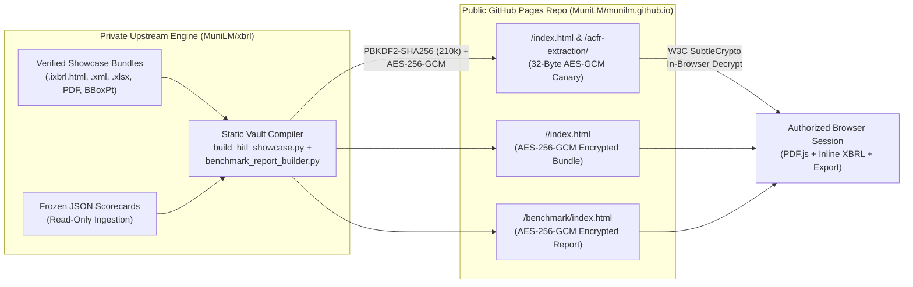

# MuniLM Prototype Workspace (`munilm.github.io`)

**Live Portal:** [https://munilm.github.io/](https://munilm.github.io/)  
**Standards Compatibility:** XBRL US GRIP 2022 (`acfr_2022.xsd`) &bull; W3C Inline XBRL 1.1 &bull; XBRL 2.1 &bull; University of Michigan CLOSUP 16-Tab `ACFR_template.xlsx` (`process-xbrl`)  
**Security Architecture:** Zero-Backend Static Bundle &bull; Client-Side `PBKDF2-HMAC-SHA256` (`210,000` iter) + `AES-256-GCM` WebCrypto Vault &bull; `no-referrer` Hardened

---

## 1. Overview

`MuniLM/munilm.github.io` hosts the compiled, client-side encrypted static showcase portal for **MuniLM's Municipal Financial Intelligence Suite**. Every interactive workstation and technical report in this repository runs **100% client-side in the browser** via the W3C `SubtleCrypto` API, with zero backend servers and zero plaintext financial payloads stored in HTML or JavaScript source.

> **Maintainers & AI Agents:** This is a **compiled artifact repository** published to a **public** GitHub Pages origin. Read **[`AGENT.md`](AGENT.md)** before running builds, modifying files, or pushing updates. Never hand-edit generated `index.html` bundles directly—compile from the upstream `MuniLM/xbrl` showcase builder.

---

## 2. Live Route Map

| Route | Status | Purpose |
| :--- | :---: | :--- |
| **[`/`](https://munilm.github.io/)** | **Live** | **MuniLM Prototype Workspace** — Top-level 4-module hub tracking `ACFR Extraction` (`Live`), `Official Statement XBRL` (`Offline`), `Internal Data Catalog` (`Offline`), and `External Data Catalog` (`Offline`). |
| **[`/acfr-extraction/`](https://munilm.github.io/acfr-extraction/)** | **Live** | **Municipal ACFR-to-XBRL Workstations Hub** — Entry hub for US GRIP 2022 & UMich CLOSUP workstations, headline verification strip, and vault unlock bar. |
| **[`/milwaukee-fy2025/`](https://munilm.github.io/milwaukee-fy2025/)** | **Live (Vault)** | Flagship full-GAAP municipal workstation (*City of Milwaukee, WI — FY2025 ACFR*). |
| **[`/boston-fy2025/`](https://munilm.github.io/boston-fy2025/)** | **Live (Vault)** | Full-GAAP municipal workstation (*City of Boston, MA — FY2025 ACFR*). |
| **[`/tampa-fy2025/`](https://munilm.github.io/tampa-fy2025/)** | **Live (Vault)** | Full-GAAP municipal workstation (*City of Tampa, FL — FY2025 ACFR*). |
| **[`/denver-water-fy2024/`](https://munilm.github.io/denver-water-fy2024/)** | **Live (Vault)** | Business-type enterprise utility workstation (*Denver Water, CO — FY2024 ACFR*). |
| **[`/alpha-park-fy2025/`](https://munilm.github.io/alpha-park-fy2025/)** | **Live (Vault)** | Special-district workstation with external state Comptroller tie-out (*Alpha Park Public Library District, IL — FY2025 ACFR*). |
| **[`/benchmark/`](https://munilm.github.io/benchmark/)** | **Live (Vault)** | **Executive & Technical Benchmark Report** — Visual architecture & ML charts, pre-registered blind-exam scorecard, interactive corpus explorer, and print/PDF layout. |

---

## 3. Architecture & Compilation Dataflow

Source code, PDF routing, vision-language extraction, neural XBRL concept mapping, offline Arelle validation, and static-site compilation live in the private **`MuniLM/xbrl`** repository (`prototype/hitl_showcase/`). This repository receives only the encrypted static output:



### Interactive Workstation Capabilities
Once unlocked in the browser with a valid MuniLM invite key, each city workstation provides:
- **Synchronized Split-Screen PDF $\leftrightarrow$ Inline XBRL Provenance:** Clicking any line item or numeric cell scrolls the embedded PDF canvas to the source statement page and highlights the exact `BBoxPt` coordinates.
- **Presentation Scale Parity (`<ix:nonFraction scale="..." decimals="...">`):** Toggle between as-printed statement units (`$ in thousands`) and full scaled USD values while inspecting GRIP 2022 concept definitions and dimensional contexts.
- **Calibrated 3-Zone Human-in-the-Loop Triage:** Filter directly to `Needs Review (*Custom / Shortlist)` rows and promote calibrated Top-5 neural concept candidates in one click.
- **Closed-Loop 4-Gate Accounting Audit:** Inspect intra-statement GASB equations (Gate 1A), cross-statement fund-to-government-wide reconciliations (Gate 1B), XBRL schema/polarity hygiene (Gate 1C), and external state Comptroller crosswalks (Gate 2).
- **Standards-Compliant Client-Side Export:** Download the live W3C Inline XBRL 1.1 (`.ixbrl.html`), populated 16-tab University of Michigan `.xlsx` workbook, and `.json`/`.csv` review audit log directly from decrypted browser memory.

---

## 4. Client-Side Cryptographic Security Model

Because GitHub Pages repositories are served from public static origins, confidentiality of demo bundles and benchmark telemetry is enforced cryptographically at build time:

1. **Key Derivation (`PBKDF2-HMAC-SHA256`):** Each compiled page derives a `256`-bit key from the invite passphrase using `210,000` PBKDF2-SHA256 iterations and a per-build CSPRNG `16`-byte salt (`secrets.token_bytes(16)`).
2. **Authenticated Encryption (`AES-256-GCM`):** Payloads are encrypted with a fresh `12`-byte nonce and `128`-bit authentication tag (`cryptography.hazmat.primitives.ciphers.aead.AESGCM`), serialized into `<script id="encryptedBundlePayload" type="application/json">`. Wrong keys fail GCM tag verification immediately.
3. **32-Byte Canary & URL-Fragment Auto-Unlock (`#key=...`):**
   - Root `/index.html` and `/acfr-extraction/index.html` embed a `32`-byte `AES-256-GCM` canary (`#portalVaultCanary`) containing zero financial data.
   - Invite links formatted as `https://munilm.github.io/#key=<INVITE_KEY>` verify the fragment against the canary *before* writing `munilm_team_vault_key_v1` to `localStorage` (preventing mistyped URLs from clobbering a valid saved key) and **immediately scrub `#key=...` from the address bar** via `history.replaceState`. Because `#` URL fragments are never sent in HTTP requests, invite keys never touch GitHub servers.
4. **Referrer & Session Hygiene:** Every HTML document sets `<meta name="referrer" content="no-referrer" />` in `<head>` and exposes a 1-click **`Lock Vault`** control in the header bar to wipe `localStorage`.

---

## 5. Repository Structure

```text
munilm.github.io/
├── .nojekyll                         # Disables Jekyll processing so static assets serve verbatim
├── .gitignore                        # Blocks keys, .env files, unencrypted bundles, and non-MD logs
├── README.md                         # Architecture, security model, and maintainer runbook (this file)
├── AGENT.md                          # Mandatory operational & security rules for AI coding agents
├── AGENTS.md                         # Standard CLI agent entrypoint pointing to AGENT.md
├── auth_config.json                  # Public client auth configuration (SSO disabled when empty)
├── demos_manifest.json               # Public card metadata for the 5 showcase cities
├── index.html                        # Root 4-card MuniLM Prototype Workspace landing page
├── acfr-extraction/
│   └── index.html                    # Municipal ACFR-to-XBRL Workstations sub-page hub
├── benchmark/
│   ├── index.html                    # AES-256-GCM encrypted Executive & Technical Benchmark Report
│   └── assets/                       # Local Figtree variable font & MuniLM brand marks
├── assets/
│   ├── brand/                        # Official MuniLM horizontal & circular logomarks
│   └── fonts/                        # Self-hosted Figtree variable font (zero external font calls)
├── milwaukee-fy2025/                 # Encrypted self-contained HITL workstation bundle
├── boston-fy2025/                    # Encrypted self-contained HITL workstation bundle
├── tampa-fy2025/                     # Encrypted self-contained HITL workstation bundle
├── denver-water-fy2024/              # Encrypted self-contained HITL workstation bundle
├── alpha-park-fy2025/                # Encrypted self-contained HITL workstation bundle
└── logs/
    └── README.md                     # Chronological engineering & deployment log index
```

---

## 6. Maintainer Rebuild & Verification Workflow

All builds originate from `<XBRL_REPO_ROOT>/prototype/hitl_showcase/`.

### Step 1 — Recompile All Encrypted Pages & City Bundles
```powershell
python <XBRL_REPO_ROOT>/prototype/hitl_showcase/rebuild_all_live_showcases.py `
  --site-root <PAGES_REPO_ROOT> `
  --vault-key-file <KEY_FILE_PATH>
```
*(Never pass `--local-unencrypted` when targeting `<PAGES_REPO_ROOT>`.)*

### Step 2 — Run Mandatory Pre-Push Cryptographic & Zero-Leak Checks
```powershell
$env:MUNILM_TEAM_VAULT_KEY = (Get-Content -Raw <KEY_FILE_PATH>).Trim()
node <XBRL_REPO_ROOT>/prototype/hitl_showcase/verify_portal_and_brief.cjs <PAGES_REPO_ROOT>
Remove-Item Env:\MUNILM_TEAM_VAULT_KEY
```
This headless W3C WebCrypto suite verifies:
- `no-referrer` meta headers across `/`, `/acfr-extraction/`, `/benchmark/`, and city pages.
- `PBKDF2-SHA256` (`210,000` iter) + `AES-256-GCM` decryption of `#portalVaultCanary` and `#encryptedBundlePayload`, plus cryptographic rejection of invalid keys.
- Zero plaintext leakage of gated entity names, unencrypted JSON keys, or confidential telemetry in raw HTML.

### Step 3 — Deploy & Confirm GitHub Pages Build
```powershell
Set-Location <PAGES_REPO_ROOT>
git status --short
git add -A
git commit -m "chore(showcase): recompile encrypted portal bundles"
git push origin main
gh api repos/MuniLM/munilm.github.io/pages --jq "{status:.status, https:.https_enforced, url:.html_url}"
```

---

## 7. License & Attribution

- **Portal UI & Showcase Assets:** Copyright &copy; MuniLM. All rights reserved.
- **Taxonomy Compatibility:** Built for compatibility with the public **XBRL US Government Reporting Information Package (GRIP) 2022** taxonomy and the **University of Michigan Center for Local, State, and Urban Policy (CLOSUP)** `process-xbrl` workbook standard.
